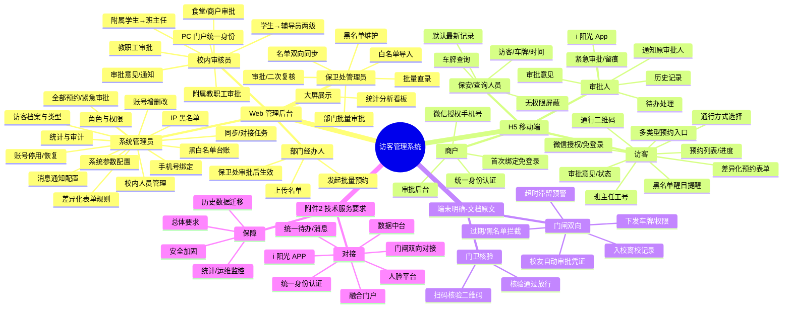

# 访客管理系统 功能思维导图

> 依据采购文档附件1《功能需求清单》、附件2《技术服务要求》整理，只保留原文内容。
> 图形版见同目录 `功能清单-思维导图.png`；文字版见 `功能清单-按端与角色.md`。

## 使用说明

- GitHub / GitLab / Typora / Obsidian / VS Code（安装 Markdown Preview Mermaid 插件）可直接渲染上面的 `mermaid` 代码块。
- 需要图片时直接使用 `功能清单-思维导图.png`（2420×2896）。
- 思维导图按“端 → 角色 → 功能点”三层展开；文档未写明端的门卫核验、门闸双向单独归入“端未明确”。
